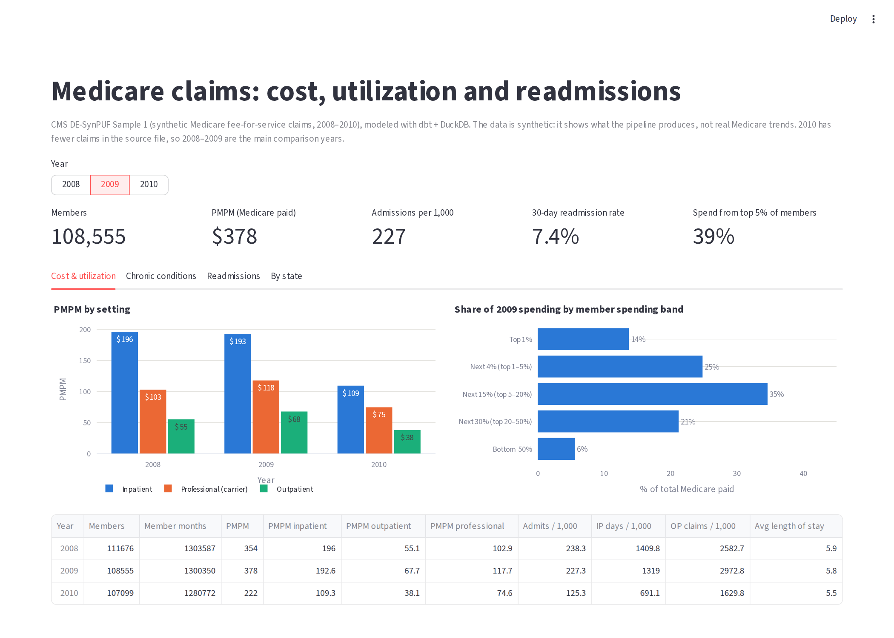
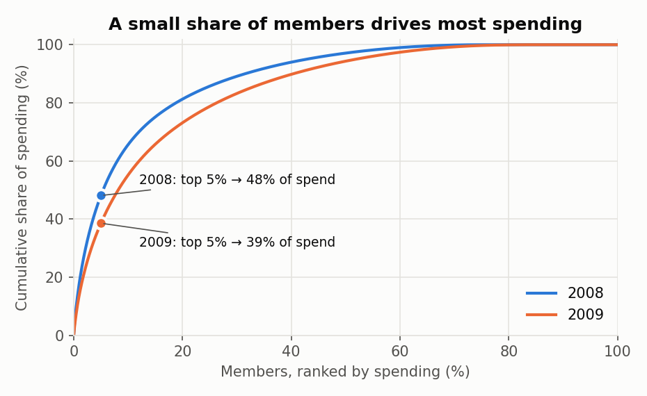
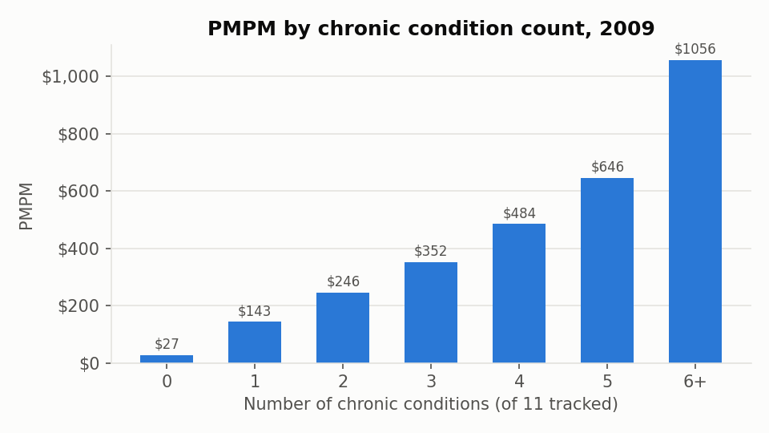
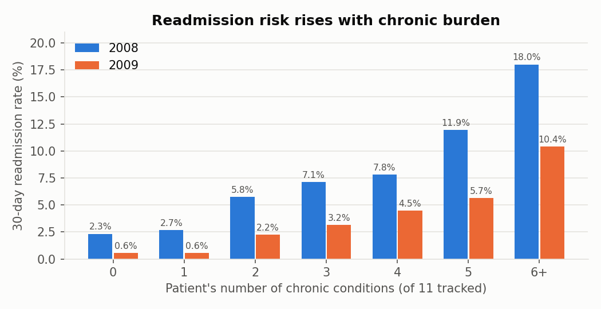
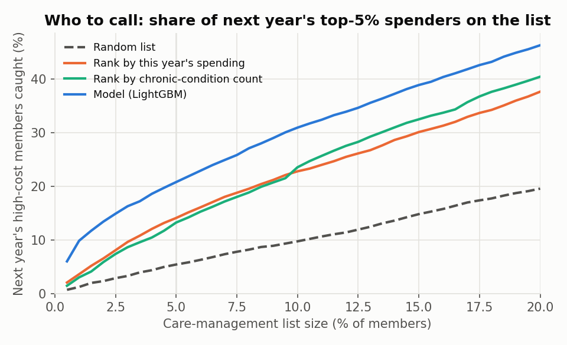

# Medicare Claims Analytics: Cost, Readmissions and Care-Management Targeting

[](https://github.com/HarshitGadge/medicare-claims-analytics/actions/workflows/ci.yml)

An end-to-end claims analytics project on CMS Medicare claims data: a **dbt + DuckDB** pipeline that turns raw beneficiary and claim
files into tested fact tables and plan-level metrics (PMPM, utilization per 1,000, 30-day readmissions), an analysis of where the money
goes and who gets readmitted, a model that picks **next year's high-cost members** for a care-management team, and dashboards in
**Streamlit** and **Power BI**.

Data: CMS 2008–2010 Data Entrepreneurs' Synthetic Public Use File (DE-SynPUF), Sample 1. It has 116,352 beneficiaries,
343,644 member-years, 66,705 inpatient claims and about 780,000 outpatient claims, in the same layout as real CMS claims files.



> **About the data.** DE-SynPUF is synthetic. CMS built it so people can develop programs that later run on real Medicare data, and
> warns that inferences drawn from it about Medicare "will be misleading and often incorrect"
> ([Data Users Document](https://www.cms.gov/research-statistics-data-and-systems/downloadable-public-use-files/synpufs/downloads/synpuf_dug.pdf)).
> The findings below describe what the pipeline produces on this file. Where the synthetic data behaves unlike real claims, that is
> stated. Claim counts also drop in 2010 in the source file, so 2008–2009 are the main comparison years.

## Findings

**1. A small share of members drives most spending.** The top 5% of members account for **48%** of Medicare payments in 2008 and **39%**
in 2009; the bottom half accounts for 3–6%. PMPM was **$354** (2008) and **$378** (2009), and about half of it is inpatient.

**2. Spending climbs steeply with chronic conditions.** In 2009, members with none of the 11 tracked chronic conditions cost **$27 PMPM**,
while members with 6 or more cost **$1,056 PMPM**. That 6+ group is 16.5% of members and **46% of spending**.

|  |  |
|---|---|

**3. Readmission rates rise with chronic burden far more than they vary by index diagnosis.** The 2008 all-cause 30-day readmission rate is
**14.7%**, the same order as published real-Medicare figures from a few years earlier (19.6% for 2003–04 discharges, Jencks et al., *NEJM* 2009).
It rises from **2.3%** for patients with no chronic conditions (a small group: 129 index stays) to **18.0%** for patients with 6 or more.
This is an association, since the condition flags come from the same year as the stay. The HRRP condition groups (AMI, heart failure,
pneumonia, COPD) sit within 2 points of each other, unlike real data, which fits CMS's warning that the synthetic process weakens
relationships between variables. The rate also falls in 2009 (7.4%) and 2010 (4.2%): repeat stays per admitted patient drop from 1.65 to
1.31 to 1.14 across the file's years, an artifact of the synthetic data. Compare within a year, not across years.



**4. A model finds more of next year's high-cost members than the rankings a team would use by default.** The target is "in next year's
top 5% of spending". The model is trained on 2008 → 2009 and tested once on 2009 → 2010 (106,186 members). With a list covering 5% of members:

| Approach | Next year's high-cost members on the list | Next year's spending on the list | PR-AUC |
|---|---|---|---|
| Random list | 5.4% | 5.3% | 0.05 |
| Rank by this year's spending | 14.1% | 11.2% | 0.10 |
| Rank by chronic-condition count | 13.2% | 11.3% | 0.10 |
| **LightGBM** (chosen over logistic regression by cross-validation) | **20.8%** | **15.1%** | **0.17** |

The gain over ranking by spending is **+6.7 percentage points** (bootstrap 95% CI +5.7 to +7.6). With a 1% list, the model catches
9.8% of next year's high-cost members vs 3.6%. (The chronic-count baseline breaks ties by this year's spending.) Absolute numbers are low
because high cost barely persists from year to year in this file: only 24.5% of 2008's top-5% members are in the top 5% again in 2009,
and 14% from 2009 to 2010. That limits every method, so the comparison should be rerun on real claims before choosing an approach.



## Pipeline

```
data/raw (CMS CSVs)                  staging (views)                     intermediate                      marts
DE1_0_20xx_Beneficiary_Summary  ─►  stg_synpuf__beneficiary_years  ─────────────────────────────────►  fct_member_years
DE1_0_..._Inpatient_Claims      ─►  stg_synpuf__inpatient_claims   ─►  int_inpatient_claims  ─►        fct_inpatient_stays (+ readmit flags)
                                                                       int_inpatient_stays              dim_beneficiaries
DE1_0_..._Outpatient_Claims     ─►  stg_synpuf__outpatient_claims  ─►  int_outpatient_claims            agg_* (PMPM, concentration, chronic
seeds/ssa_state_codes.csv                                                                                burden, conditions, readmissions, state)
```

- **Staging** types every column (the CSVs are read as text) and decodes codes from the CMS codebook: sex, race, SSA state, the chronic-condition flags.
- **Hospital stays** merge overlapping claims, same-day admissions and next-day transfers to a different provider into one stay
  (gaps-and-islands on admission and discharge dates), following the CMS readmission measures' treatment of transfer chains.
- **Readmissions:** an index stay is discharged alive with 30 days of follow-up left in the data, and a readmission is any stay starting
  1–30 days later. Condition groups use simplified CMS HRRP ICD-9 cohorts. Definitions are in [`docs/metrics.md`](docs/metrics.md),
  including the ways this is simpler than the official CMS measures (no planned-readmission algorithm, no age-65+ restriction, no risk adjustment).
- **Tests (all 48 steps of `dbt build` pass):**
  - 27 generic data tests: unique and not-null keys, accepted values, relationships to the state seed and the beneficiary dimension.
  - 3 custom SQL tests:
    - a **reconciliation test**: inpatient payments summed from claims must match the beneficiary summary file within 6% for every year;
    - no stay discharged before its admission;
    - a warning if negative (adjustment) payments exceed 0.5% of claim segments.
  - 2 **dbt unit tests** with hand-built fixtures: one for transfer and overlap merging, one for the readmission window and its exclusions.
- **CI** (GitHub Actions) runs `dbt build` on a committed 1% beneficiary sample, plus pytest checks on the exported marts and a Streamlit
  app smoke test for each year.

## Dashboards

- **Streamlit** (`app/streamlit_app.py`) reads the aggregate marts in `exports/*.csv`, so it runs without the raw data. It has a year
  selector, KPI tiles, tabs for cost and utilization, chronic conditions, readmissions and a state map, all with hover tooltips.
- **Power BI:** `exports/*.parquet` holds a star schema (member-year and stay facts plus a beneficiary dimension).
  [`docs/powerbi.md`](docs/powerbi.md) covers relationships, DAX measures (PMPM, admits per 1,000, readmission rate, top-5% spend share),
  suggested pages, and the totals your cards should match.

## Run it

```bash
python -m venv .venv && source .venv/bin/activate
pip install -r requirements.txt

# Quick start on the committed 1% sample (about 10 seconds)
dbt build --project-dir dbt --profiles-dir dbt --vars '{raw_dir: data/sample, ip_reconciliation_tolerance: 0.10}'

# Full data: download CMS DE-SynPUF Sample 1 (about 48 MB zipped, 220 MB of CSV) and build
./scripts/download_data.sh
dbt build --project-dir dbt --profiles-dir dbt          # about 10 seconds with DuckDB
python scripts/export_marts.py                          # refresh exports/ for the dashboards
jupyter nbconvert --to notebook --execute --inplace analysis/claims_analysis.ipynb

streamlit run app/streamlit_app.py
pytest -q tests
```

## Repository layout

```
dbt/
  models/staging/          typed, decoded source tables
  models/intermediate/     claims with segments combined, hospital stays
  models/marts/            fact, dimension and aggregate tables, with docs and tests (_marts.yml)
  macros/                  HRRP condition-group mapping
  seeds/                   SSA state codes
  tests/                   reconciliation and data-quality tests
analysis/claims_analysis   notebook (.ipynb, executed) and paired script (.py)
app/streamlit_app.py       dashboard
exports/                   CSV aggregates and Parquet star schema for BI tools
docs/                      metric definitions, Power BI guide
data/sample/               1% beneficiary sample used by CI
scripts/                   download, sampling and export scripts
tests/                     pytest checks and app smoke test
```

Tools: SQL, dbt (dbt-duckdb), DuckDB, Python (pandas, scikit-learn, LightGBM), Streamlit, Plotly, Power BI, GitHub Actions.
